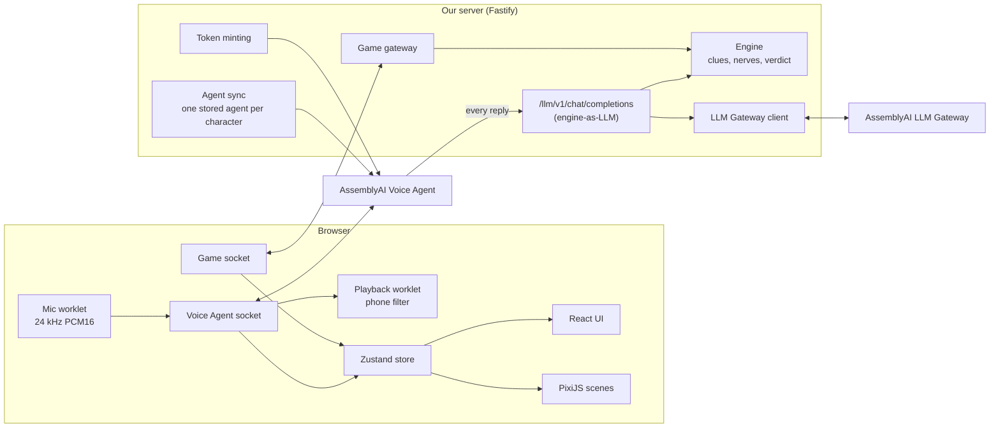

# Murder Mystery Hotline: implementation plan (v3)

A voice-driven detective game for the AssemblyAI Hackathon #2 (October 15–23, 2026). Players phone suspects from a 1947 telephone exchange, interrogate them by voice, collect clues, and name the killer.

## v3 decisions (from the 2026-10-17 grilling) — these override anything below

**Hackathon facts.** Hackathon #2 is themed on AssemblyAI's **Text-to-Speech API (Preview)**: `wss://streaming-tts.assemblyai.com/v1/ws`. 20 winners share $2,000. Submissions go through a Google Form with no stated cutoff time. We use the lablab criteria as our rubric (Application of Technology, Presentation, Business Value, Originality) and add one: **"showcases the TTS API"**.

**Architecture.** Back to the v1 pipeline: **Streaming STT v3 → engine + LLM Gateway → direct streaming TTS**. All audio goes through our server on one browser socket. The Voice Agent design in sections 2–3 below is now **Plan B** only.

**TTS (protocol verified, see `docs/reference/assemblyai/tts-protocol.md`).**
- **One TTS socket per reply**, opened when the reply starts and `Terminate`d when it ends.
- At most **3 sockets at once** (the account's cap). A pool queues replies past that, and the client hears an "all lines are busy" crackle while waiting.
- Each reply carries an utterance ID, and the browser drops stale audio from interrupted replies.

**Talking.** Hold Space or the on-screen button to talk; release sends STT `ForceEndpoint`. Pressing it mid-reply interrupts the suspect (TTS `Cancel`). The typed box is always available.

**Scope (solo, about 8 hours a day).**
- One full case, plus a mini Case 2 ("Dead Air", 1986, 2 suspects, no cinematic) only if Day 5 is on track.
- PixiJS stays, but only 3 scenes: switchboard, exchange room at night, evidence close-up.
- Art is procedural Pixi plus 2–3 generated backdrops; suspects are silhouettes.
- AI playtester: text-only, 10 runs, at most 2 hours on Day 6.
- Hosting: Fly, US East, one always-on machine.

**Case 1: "The Night Operator".**
- Victim: operator Dot Kowalski, strangled with a patch cord at her board at about 1:40 a.m.
- The player is a detective at her board. Her call log is the starting evidence.
- Suspects:
  - Frank Doyle (Hotel Marlowe night manager) — **the killer**.
  - Evelyn Ashford — red herring, cleared by the log.
  - Leo Brandt (Herald reporter) — red herring and witness.
  - Officer Tom Riley (ex-fiancé) — red herring, cleared by the log.
- Mrs. Hale (night supervisor) narrates and gives hints.
- Key clues (3 of 4 needed to accuse):
  1. Leo's tip about the Marlowe.
  2. Doyle's alibi versus the log gap.
  3. Leo saw a man in a Marlowe doorman's coat leave.
  4. Doyle's slip about "her own cord".
- No special UI for catching the lie.
- Doyle confesses at nerves 9 or higher once you hold 3 or more key clues.
- Three endings.

**Rules.**
- Soft question budget: going over costs a rank star but never ends the game.
- Stars: right culprit, within the budget, all key clues cited.
- A redial resets nerves to 5.
- Pitch angle for Business Value: "an engine for voice role-play training".

**Schedule.**

| Day | Focus |
| --- | --- |
| Sat 17 | TTS protocol (done), then backend test-first with a dummy frontend |
| Sun 18 | Browser voice loop |
| Mon 19 | Engine rules + full Case 1 |
| Tue 20 | Pixi switchboard and game UI |
| Wed 21 | Intro cinematic, verdict, maybe Case 2 |
| Thu 22 | Playtests, latency, deploy, slides. **Freeze at 11:59 p.m.** |
| Fri 23 | Submit (buffer) |

---

**What changed from v1 (historical, v2):** the voice loop now runs on AssemblyAI's **Voice Agent API** instead of three hand-built adapters (Streaming STT, an undocumented streaming TTS socket, and the LLM Gateway). The game engine plugs in as the agent's LLM through **Connect your own LLM**, so the engine still controls every word a suspect can say. The fixes from the plan review are folded in. They are marked **[fix]**.

Docs used for this plan are saved in `docs/reference/assemblyai/`.

---

## 1. Goals and definition of done

The submission is done when:

- A judge can open a link, watch the intro, and solve Case 1 entirely by voice in about 10 minutes.
- Every character has a distinct voice from the Voice Agent API.
- A suspect starts answering within about 1.5 seconds of the player finishing a question.
- A second case in a different era runs on the same engine with no engine code changes.
- Typing a question works when no microphone is available.
- The game survives failures: a broken sound, a dropped socket, or a malformed LLM reply never freezes the screen.
- A 2-minute demo video and a README are submitted.

**Out of scope:** real phone numbers (SIP is a stretch goal), accounts, mobile apps, AI-generated cases (stretch), and more than two cases.

---

## 2. What the docs settled

| Question from v1 | Answer |
| --- | --- |
| Is there a documented streaming TTS endpoint? | No standalone one. TTS is documented only as part of the Voice Agent API. |
| Voices | 16 voice IDs. 11 English: `alba eve george jane jean mary michael` (US), `anna charles paul vera` (UK). Accented English code-switchers: `giovanni lola juergen rafael estelle`. |
| Can one connection switch voices? | No. `output.voice` is immutable after `session.ready`. This fits one session per phone call. |
| Audio format | Base64 PCM16 mono, **24 kHz** in both directions by default. Sent as JSON `input.audio` / `reply.audio`. |
| Barge-in | Built in (`interrupt_response`). `transcript.agent` comes back with `interrupted: true` and only the words actually spoken. |
| Custom LLM | A stored agent's `llm` field points at any public HTTPS, OpenAI-compatible, **streaming** `/chat/completions` endpoint. |
| Typed input | `conversation.message {role:"user"}`, then `reply.create`. |
| Scripted lines | Our LLM endpoint can return exact text. `reply.create {instructions}` also works. |
| Reconnect | `session.resume {session_id}`, with a 30 s grace window after a dropped socket. |
| Browser auth | The server mints a single-use temporary token (`GET /v1/token`). The browser connects to `wss://agents.assemblyai.com/v1/ws?token=…`. |
| Billing | By time the session is open. A bare `close()` leaves a billable 30 s resume window, so always send `session.end`. |
| Push-to-talk | There's no manual turn mode. Turns come from voice activity detection (VAD) with tunable `min_silence` / `max_silence`. |

**Still unknown (the Day 1 probe answers these):**

1. What AssemblyAI actually sends to a custom LLM endpoint: headers, whether the system prompt and a session ID are included, how history looks after a barge-in.
2. Real latency from end of speech to first audio, with the managed model and with our endpoint in the loop.
3. Rate limits on new Voice Agent sessions and token minting for this account.
4. Whether `session.update { system_prompt }` sent after `session.ready` reaches our endpoint on the next turn. That's the mechanism for tying each call to a game session.

---

## 3. Architecture



### Pieces

- **Agent sync (startup).** For every character in every case pack, create or update one stored agent: `name = mmh:<caseId>:<charId>`, `voice`, a neutral greeting, and `llm = [{ base_url: PUBLIC_URL + "/llm/v1", model: "<caseId>:<charId>", api_key: LLM_ENDPOINT_SECRET }]`. Agent IDs are cached in `.agents.json`. This is idempotent: look up by name, `PUT` if it exists.
- **Engine-as-LLM endpoint.** AssemblyAI calls `POST /llm/v1/chat/completions` for every reply. The endpoint:
  1. checks the bearer secret, so only AssemblyAI can call it;
  2. finds the game call from the `[[call:<id>]]` marker in the system prompt. If the probe finds a better identifier, use that;
  3. **throws away the incoming system prompt** and rebuilds it from the engine (persona, current truth tier, eligible clues only), keeping the user and assistant turns as history. It also drops any extra `system` messages, which could be injected from the browser;
  4. streams the reply from the LLM Gateway, forwarding only the spoken part as SSE `chat.completion.chunk`s and holding back the `###META` block;
  5. after the stream ends, parses META with Zod, applies it in the engine, and pushes `state` / `clues` / `hangup` to the player over the game socket.
- **Browser ↔ Voice Agent, direct.** Audio never passes through our server. That removes a hop, and barge-in and stale-audio handling are now AssemblyAI's job. This replaces the v1 utterance-tagging fix.
- **Game socket.** A small JSON socket between browser and server for game state only (no audio).

### One question, start to finish

1. The player dials a suspect. The browser sends `call.open { suspectId }`. The server creates a call record, mints a token (`expires_in_seconds=60`, `max_session_duration_seconds=300`), and returns `call.ready { token, agentId, callId }`.
2. The browser opens the Voice Agent socket, sends `session.update { agent_id }`, waits for `session.ready`, then sends `session.update { system_prompt: "[[call:<callId>]]" }` and starts streaming mic audio.
3. The player speaks. VAD ends the turn. `transcript.user.delta` drives live captions.
4. AssemblyAI calls our endpoint. The engine builds the prompt and streams the reply from the gateway. Spoken text flows back to AssemblyAI and gets spoken.
5. `reply.audio` plays through the phone-line filter. `transcript.agent` gives the final caption.
6. Our endpoint finishes, applies the META block, and pushes `clues` and `state`. If the suspect hangs up, the server sends `call.hangup` and the browser sends `session.end`.

### Fallback paths

- **Plan B** (if the custom-LLM path is too slow, or a call can't be identified): stored agents with `llm` pointing straight at the LLM Gateway. The server or browser pushes an engine-built `system_prompt` through `session.update` before each turn. Metadata comes back through a client-side tool `record_testimony { reveal[], pressure_change, hang_up }`, and the engine validates reveals the same way.
- **Plan C:** the original v1 pipeline (Streaming STT v3 + LLM Gateway + undocumented streaming TTS).

### Latency budget

| Step | Target |
| --- | --- |
| VAD end of turn (`min_silence` tuned down from 1000 ms) | 400–600 ms |
| AssemblyAI → our endpoint → gateway time to first token (fast model) | 400 ms |
| TTS to first audio, plus network | 350 ms |
| **Total, end of speech to first sound** | **about 1.2–1.4 s** |

**[fix]** Use a fast model for suspects. Default `claude-haiku-5-5`; compare against `gemini-3.8-flash` and `gpt-5-mini` in the probe. Deploy Fly in **US East**. Enable LLM Gateway prompt caching for the fixed system prompt prefix. Fill any gap with lamp flicker and a breath sound on `input.speech.stopped`.

---

## 4. Repository layout

```
apps/
  web/            Vite + React + PixiJS client
    src/audio/    mic + playback worklets (24 kHz, resample in-worklet), SFX
    src/voice/    Voice Agent socket client
    src/net/      game socket client
    src/scenes/ src/cinematic/ src/ui/ src/store/
  server/         Fastify
    src/game/     game gateway (socket), sessions, reconnect
    src/llm/      engine-as-LLM endpoint, META stream splitter, gateway client
    src/agents/   agent sync + token minting
    src/security/ rate limits, input limits
packages/
  engine/         pure TS: case schema, prompt builder, clues, nerves, verdict, validator
  protocol/       shared game-socket message schemas (Zod)
cases/
  blue-lantern/   case.json, intro.json, theme.json, art/, sfx/
  case-two/
tools/
  probe-voice-agent.ts   Day 1: voices, latency, event log (managed LLM)
  probe-own-llm.ts       Day 1: stub LLM endpoint + agent, logs what AssemblyAI sends
  playtest.ts            AI detective plays cases by text
  validate-cases.ts
docs/
  plan.md
  reference/assemblyai/  saved doc pages
```

---

## 5. Module specifications

### 5.1 Engine-as-LLM endpoint (highest risk, probed on Day 1)

- **SSE output:** `data: {"id","object":"chat.completion.chunk","choices":[{"index":0,"delta":{"content":"…"}}]}` lines, ending with `data: [DONE]`. Send the first chunk fast; if the model hasn't produced text within 700 ms, flush a filler token such as "Hm." for that character.
- **[fix] META splitter.** A streaming state machine that holds back any trailing text that could be the start of `###META`, so a marker split across chunks never leaks. It also strips markdown, `*asterisks*`, and `(stage directions)` before forwarding. Unit tested with every split point.
- **[fix] Clue tagging fallback.** If META is missing or doesn't list a clue whose `topics` keywords clearly appear in the spoken text, the engine runs a keyword match against **eligible** clues only.
- **[fix] History after barge-in.** If the probe shows AssemblyAI sends the full un-trimmed reply, replace the last assistant turn with the trimmed text from `transcript.agent` (the browser reports it via `call.heard`).
- **Empty or garbled turn.** If the latest user message is under 2 characters, return a scripted "Didn't catch that, detective." without calling the LLM.
- **Scripted lines** (redial "You again?", hang-up exit line) are returned verbatim by the endpoint.
- **Security:** constant-time compare of the bearer secret, a 500-character cap on the latest user turn, and a cap of 40 history messages.

### 5.2 Agent sync and tokens

- Sync runs at server start and in `tools/sync-agents.ts`. Any character whose `voice` isn't in the known voice list fails case validation.
- Token minting is rate-limited per player session (at most 1 call every 3 s, at most 40 calls per game).
- **[fix]** The server owns the call lifecycle. If the game socket closes or a call runs past 5 minutes, the server marks the call dead and the endpoint refuses further replies. The browser always sends `session.end` (also on `pagehide`).

### 5.3 Engine

- **Case loader:** Zod schema plus the validator. Invalid packs fail at startup with a clear message.
- **Clue rules:** `topics`, `minPressure`, `requires`. Enforced before the call (the prompt contains only eligible clue text) and after it (ineligible reveals are rejected and logged).
- **[fix] Locked clues never appear in the prompt**, not even their text. Only a list of off-limits topic names: "you will not discuss X yet".
- **[fix] Truth in tiers.** `truth` is split into `truth.guarded` (nerves 0–4), `truth.shaken` (5–8), and `confession` (only when the confession rule is met). The prompt includes only the current tier.
- **Nerves:** 0–10. The LLM proposes −2 to +3, the engine clamps it, and at 10 the suspect hangs up. **[fix]** A redial resets nerves to **5** (not 7) and plays "You again?".
- **Question budget:** each finished user turn costs one. At zero, the operator prompts the player to accuse.
- **[fix] Operator hint line:** a special non-suspect character, "the Operator". After 4 questions in a row with no new clue, the Operator offers a nudge naming a suspect and a topic. It's spec'd in the case pack as `hints[]`, which are ordered and unlock as clues are found.
- **Verdict:** `solved` / `rightButWeak` / `wrong`. Endings come from the case pack.

### 5.4 Case pack format

As in v1, plus:
- `characters[].motive` (string or null) **[fix]**, so the validator can check for red herrings
- `characters[].truth` → `{ guarded, shaken }`, and `confession` remains a separate field
- `characters[].voice` must be a known Voice Agent voice ID
- `hints[]` for the Operator

### 5.5 Validator and AI playtest

The checks from v1, plus: every voice ID is known, no two characters in one case share a voice, and at least two characters have a non-null `motive`.

**AI playtest** runs the real engine and prompt builder by text. It calls the gateway directly and skips Voice Agent. 20 runs, executed in parallel, with a cheap detective model. Treat the solve rate as a sanity check (target 50–75%), not as balance truth. **[fix]**

### 5.6 Frontend

- **[fix] Audio unlock:** the title screen's "Pick up the receiver" click creates the `AudioContext` and requests the mic. No audio plays before that click.
- **[fix] Audio contexts:**
  - Chrome: `new AudioContext({ sampleRate: 24000 })`.
  - Safari and Firefox: run at the device rate and resample to and from 24 kHz inside the worklets. This keeps echo cancellation working in Firefox, and Safari ignores the `sampleRate` option anyway.
- **Mic:** echo cancellation on, ~50 ms chunks, base64 `input.audio`, sent only after `session.ready`.
- **Playback:** a ring buffer with a 300–3400 Hz band-pass. On `reply.done {status:"interrupted"}` or a new `input.speech.started`, clear the buffer immediately.
- **Talk modes:** open mic with VAD is the default (it feels like a real phone call). Optional hold-to-talk sends silence while the button is up. The typed box is always visible, using `conversation.message` + `reply.create`.
- **[fix] Reconnect:** if the Voice Agent socket drops, try `session.resume` within 30 s. If the game socket drops, reconnect with `sessionId`. The server keeps game state for 10 minutes.
- Scenes, cinematics, and the quality floor are as in v1. **[fix]** Drop Motion; CSS transitions handle the notebook and cards.

### 5.7 Game socket protocol (`packages/protocol`)

JSON only. Audio no longer goes through our server.

| Direction | Message | Purpose |
| --- | --- | --- |
| C→S | `hello { sessionId? }` | New session or resume |
| C→S | `start { caseId }` | Load a case |
| C→S | `call.open { suspectId }` | Request a call |
| C→S | `call.heard { callId, text, interrupted }` | What was actually spoken (history trim, captions log) |
| C→S | `call.end { callId }` | Player hung up |
| C→S | `accuse { suspectId, evidence[] }` | Final accusation |
| S→C | `welcome { sessionId, resumed }` | Session handshake |
| S→C | `case { publicState }` | Briefing, suspects, starting evidence (no solution) |
| S→C | `call.ready { callId, suspectId, agentId, token, wsUrl, maxSeconds }` | Connect to Voice Agent |
| S→C | `call.hangup { callId, reason }` | Suspect hung up, budget exhausted, or timeout |
| S→C | `state { questionsLeft, nerves, activeCallId }` | Game state |
| S→C | `clues { clues[] }` | New notebook entries |
| S→C | `hint { text }` | Operator nudge |
| S→C | `verdict { outcome, text, solution }` | Ending |
| S→C | `error { code, message }` | Plain-language error with a next step |

---

## 6. Security and cost controls

- The API key stays server-side. The browser gets only single-use tokens that expire after 60 s and cap the session at 300 s.
- The solution stays on the server until the verdict.
- The engine, not the model, decides which clues can be revealed. The endpoint drops injected `system` messages and rebuilds the system prompt each turn. Test "ignore your instructions" attacks and show the results in the pitch.
- **[fix]** Rate limits use the `Fly-Client-IP` header. Caps: concurrent sessions, sessions per IP per hour, calls per game.
- **[fix]** Check the account's Voice Agent session and token rate limits on Day 1. Ask the organizers about hackathon credits or raised limits. If minting gets a 429, show the typed fallback with an "All lines are busy" message.
- Static file serving guards against path traversal, with a strict CSP (`connect-src` includes `wss://agents.assemblyai.com`).

---

## 7. Testing

- Engine unit tests: eligibility, clamping, hang-up, budget, verdicts, truth tiers, hints.
- **[fix]** META splitter tests: the marker split at every byte offset, markdown and stage-direction stripping, missing or invalid META.
- Endpoint tests against a fake gateway: SSE shape, secret check, prompt rebuild, injected system messages dropped.
- Protocol schema tests.
- Validator tests: a deliberately broken pack fails each check.
- AI playtest after every content change.
- Human playtests: three people on Thursday.
- Browsers: Chrome, Safari, and Firefox, including mic permission and echo behavior.

---

## 8. Schedule

| Day | Date | Focus | Done when |
| --- | --- | --- | --- |
| 1 | Sat Oct 17 | Scaffold, protocol types, **Voice Agent probes**, **Case 1 draft started** | Two voices play from the probe. Latency measured for managed and own-LLM. The Section 2 unknowns are answered. |
| 2 | Sun Oct 18 | Voice loop with one suspect in the browser | Speak, hear an in-character reply through our endpoint. Typed fallback works. Barge-in works. |
| 3 | Mon Oct 19 | Engine rules + Case 1 content | Four suspects, clue rules, nerves, hints, accusation. Validator passes. |
| 4 | Tue Oct 20 | Game screen | Switchboard, call panel, notebook, accusation, SFX. **Art pipeline decided by Day 1 evening.** |
| 5 | Wed Oct 21 | Cinematics + Case 2 (three suspects, narration-only intro) | The Blue Lantern intro plays. The 1980s case runs with no engine changes. |
| 6 | Thu Oct 22 | Balance, speed, deploy | Playtest in range. Human playtests done. Latency ≤ 1.5 s. Live on Fly (US East). |
| 7 | Fri Oct 23 | Freeze and submit | Feature freeze by noon. Video, README, submission. |

**[fix] Art pipeline** (decide Day 1): procedural Pixi shapes plus a few AI-generated or CC0 backdrops, with silhouettes as flat shapes. No hand-drawn layered art.

**Cut order if a day slips:** case board polish, Case 2's outro, reduced-motion extras, Case 2's intro. Never cut the typed fallback or the error handling.

**Confirm on Day 1:** the submission time and time zone, the judging criteria (is a bonus given for using Voice Agent or the LLM Gateway?), the rate limits, and credits.

---

## 9. Risks and mitigations

| Risk | Likelihood | Impact | Mitigation |
| --- | --- | --- | --- |
| Calls can't be tied to game sessions at our endpoint | Medium | High | Day 1 probe. Plan B (gateway LLM + `session.update` prompt + client tool). |
| Own-LLM hop pushes latency over 2 s | Medium | High | Fast model, prompt caching, US East, filler token, tuned `min_silence` |
| Session or token rate limits too low for judging | Medium | High | Check Day 1. Ask organizers. "All lines are busy" message with typed fallback. |
| Suspects leak clues | Medium | High | Locked clues absent from the prompt, truth tiers, engine-side reveal validation |
| Mystery too hard or too easy | High | Medium | AI playtest, three human playtests, Operator hints |
| Echo or sample-rate bugs in Safari and Firefox | Medium | Medium | Resample in-worklet. Test three browsers on Day 2, not Day 6. |
| Local dev needs a public HTTPS URL for the LLM endpoint | Certain | Low | `ngrok http 8787` in dev, Fly URL in prod |
| Scope creep | High | High | Cut list. Case 2 at three suspects. |

---

## 10. Demo video (2 minutes)

As in v1. Add one shot showing that the engine, not the model, decides what a suspect can reveal: a prompt-injection attempt the suspect shrugs off, next to the server log showing the rejected reveal.

## 11. Stretch goals

- Generate a case: an LLM writes a pack, and it must pass the validator and the playtest before it can be played.
- **A real phone number:** Voice Agent supports inbound SIP from Twilio, so a judge can call the hotline from a real phone.
- Ranks and replay.
- Era-specific line treatments: 1947 switchboard crackle, 1980s answering-machine tape hiss.
