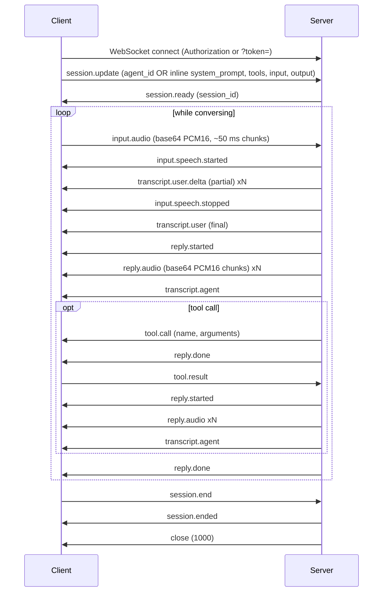

> ## Documentation Index
> Fetch the complete documentation index at: https://assemblyai.com/docs/llms.txt
> Use this file to discover all available pages before exploring further.

# Message Sequence

This page is the canonical reference for the Voice Agent WebSocket protocol: every event the client sends, every event the server emits, and the order they appear in. For the field-level schema of each event, see the [Voice Agent WebSocket API reference](/docs/voice-agents/voice-agent-api/api-spec/voice-agent-websocket) and the [Events reference](/docs/voice-agents/voice-agent-api/events-reference).

## Sequence diagram



## Events at a glance

**Client → server**

| Event | Purpose |
| - | - |
| `session.update` | Configure the agent. First message after connect; can also be sent mid-session to update mutable fields. |
| `session.resume` | Resume a previous session by `session_id`. |
| `input.audio` | Stream a chunk of PCM16 audio to the agent (base64-encoded). |
| `tool.result` | Return the result of a tool invocation the agent requested. |
| `reply.create` | Ask the agent to generate a reply now, optionally with one-shot instructions. |
| `session.end` | Cleanly end the session. |

**Server → client**

| Event | When | Purpose |
| - | - | - |
| `session.ready` | Once, after `session.update` is applied | Session established. Includes the `session_id`. Start streaming audio. |
| `session.updated` | After a mid-session `session.update` | Acknowledges the update was applied. |
| `input.speech.started` | Per user turn | Turn detection determined the user started speaking. |
| `transcript.user.delta` | Repeatedly during a user turn | Partial transcript of the current user utterance. |
| `input.speech.stopped` | Per user turn | Turn detection determined the user stopped speaking. |
| `transcript.user` | Once per user turn | Final transcript of the user's utterance. |
| `reply.started` | Per agent reply | Agent has begun generating a reply. |
| `reply.audio` | Repeatedly during a reply | A chunk of the agent's spoken response as base64 PCM16. |
| `transcript.agent` | Per agent reply | Text of the agent's response, sent after all reply audio has been delivered. |
| `tool.call` | When the agent invokes a tool | The agent wants to run a registered tool. Respond with `tool.result`. |
| `reply.done` | End of each reply | Marks the end of a reply. If a `tool.call` preceded it, send `tool.result` next. |
| `session.ended` | Once, last message | Session totals and clean shutdown. Nothing follows it. |
| `session.error` | On failure | Session- or protocol-level error. |

## Session initialization

Immediately after the WebSocket opens, send a `session.update` to configure the agent. You have two ways to configure:

* **Stored agent.** Send `{ "agent_id": "<id>" }` to bind to an agent created via the [Agents REST API](/docs/voice-agents/voice-agent-api/api-spec/create-agent). The stored `system_prompt`, `greeting`, `tools`, `input`, and `output` are applied server-side.
* **Inline configuration.** Omit `agent_id` and send `system_prompt`, `greeting`, `tools`, `input`, and `output` directly.

The two modes are mutually exclusive. See [Deploy your agent](/docs/voice-agents/voice-agent-api/deploy) and [Session configuration](/docs/voice-agents/voice-agent-api/session-configuration) for details.

```json theme={null}
{
  "type": "session.update",
  "session": {
    "system_prompt": "You are a concise assistant.",
    "greeting": "Hi! How can I help?",
    "input":  { "format": { "encoding": "audio/pcm" } },
    "output": { "voice": "alba", "format": { "encoding": "audio/pcm" }, "volume": 100 }
  }
}
```

The server responds with `session.ready` once the session is established:

```json theme={null}
{
  "type": "session.ready",
  "session_id": "3207b601-2054-48df-ba77-8784dfcf9fb8"
}
```

<Tip>
  Save `session_id` — you'll need it to reconnect with `session.resume` if the WebSocket drops mid-conversation.
</Tip>

## Sending audio

After `session.ready`, stream audio to the agent as `input.audio` events. Each event carries a base64-encoded chunk of PCM16 audio:

```json theme={null}
{
  "type": "input.audio",
  "audio": "<base64-encoded PCM16>"
}
```

Send audio in chunks of roughly 50 ms. The default input format is mono 24 kHz PCM16; you can change encoding and sample rate through `session.input.format`. See [Audio format](/docs/voice-agents/voice-agent-api/audio-format) for supported encodings and how to stream and play the bytes.

<Warning>
  Do not send `input.audio` before `session.ready`. Audio sent before the session is established is discarded.
</Warning>

## User turn

When turn detection decides the user has started speaking, the server emits `input.speech.started`. As speech continues, partial transcripts stream back as `transcript.user.delta`. When the user stops speaking, the server emits `input.speech.stopped` followed by a final `transcript.user`:

```json theme={null}
{
  "type": "input.speech.started"
}
```

```json theme={null}
{
  "type": "transcript.user.delta",
  "delta": "hey there"
}
```

```json theme={null}
{
  "type": "input.speech.stopped"
}
```

```json theme={null}
{
  "type": "transcript.user",
  "text": "Hey there, what's the weather in Paris?"
}
```

See [Turn detection and interruptions](/docs/voice-agents/voice-agent-api/turn-detection-and-interruptions) for tuning turn detection.

## Agent reply

Once the user turn ends, the agent generates a reply. Every reply is bracketed by `reply.started` and `reply.done`. In between, audio streams back as `reply.audio` events (base64 PCM16), and the full text arrives as `transcript.agent` after all audio has been delivered:

```json theme={null}
{ "type": "reply.started" }
```

```json theme={null}
{ "type": "reply.audio", "data": "<base64 PCM16 chunk>" }
```

```json theme={null}
{
  "type": "transcript.agent",
  "text": "It's 18 degrees and sunny in Paris right now."
}
```

```json theme={null}
{ "type": "reply.done" }
```

<Note>
  `transcript.agent` is emitted **after** the final `reply.audio` chunk, so it can be used to display the agent's reply once playback completes.
</Note>

## Tool calls

If the agent decides to invoke a registered tool, the server emits a `tool.call` event. The current reply ends with `reply.done`, and the client is expected to run the tool and return the result via `tool.result`. A fresh `reply.started` … `reply.done` cycle follows once the tool result is received:

```json theme={null}
{
  "type": "tool.call",
  "call_id": "call_01H...",
  "name": "get_weather",
  "arguments": { "city": "Paris" }
}
```

```json theme={null}
{
  "type": "tool.result",
  "call_id": "call_01H...",
  "result": "{\"temperature_c\": 18, \"condition\": \"sunny\"}"
}
```

See [Tool calling](/docs/voice-agents/voice-agent-api/tools/overview) for the full tool-calling flow, including HTTP tools and client-side tools.

## Updating configuration mid-session

You can send another `session.update` at any time to change mutable fields such as `system_prompt`, `input.turn_detection`, or `output.volume`. The server acknowledges with `session.updated`. Changing immutable fields (for example `greeting`, `output.voice`, or `output.format`) raises `immutable_field`. See [Mutability after `session.ready`](/docs/voice-agents/voice-agent-api/session-configuration#mutability-after-session-ready).

## Session termination

To end a session cleanly, send `session.end`. The server flushes any in-flight events, emits `session.ended`, then closes the WebSocket with code `1000`:

```json theme={null}
{ "type": "session.end" }
```

```json theme={null}
{
  "type": "session.ended",
  "session_duration_seconds": 123.4,
  "audio_duration_seconds": 45.6,
  "timestamp": 1752969600.123
}
```

<Warning>
  **Always send `session.end` before closing the WebSocket.** A bare `ws.close()` leaves the session in a 30-second [`session.resume`](/docs/voice-agents/voice-agent-api/events-reference#session-resume) grace window that is billable. See [Ending the session cleanly](/docs/voice-agents/voice-agent-api/browser-integration#6-ending-the-session-cleanly) for browser and server-client patterns.
</Warning>

## Errors

If the session fails at any point, the server sends a `session.error` event and closes the connection:

```json theme={null}
{
  "type": "session.error",
  "error_code": "immutable_field",
  "message": "Field 'session.output.voice' cannot be changed after session.ready."
}
```

See [Troubleshooting](/docs/voice-agents/voice-agent-api/troubleshooting) for the full list of error codes and recovery guidance.
